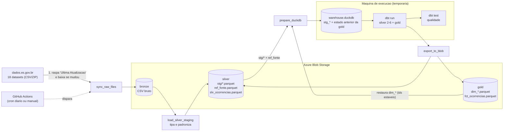

# Pipeline de Criminalidade -- Azure Blob Storage + DuckDB + dbt

Pipeline medalhao (bronze -> silver -> gold) com os dados abertos de criminalidade do
Espirito Santo (`dados.es.gov.br`). Armazenamento em Azure Blob Storage, transformacao
com dbt sobre DuckDB local, orquestracao via GitHub Actions.

## Diagrama



| Camada | Container Azure | Formato | Quem escreve |
|---|---|---|---|
| Bronze | `bronze` | CSV (bruto, como veio do site) | `src/sync_raw_files.py` |
| Silver (staging, etapa 1) | `silver` (`stg/*.parquet`, `ref_fonte.parquet`) | Parquet | `src/load_silver_staging.py` |
| Silver (final) | `silver` (`slv_ocorrencias.parquet`) | Parquet | dbt (DuckDB) |
| Gold | `gold` (`dim_*.parquet`, `fct_ocorrencias.parquet`) | Parquet | dbt (DuckDB) |

> Os nomes dos containers vem de `config/settings.json` (`azure.bronze_container`,
> `silver_container`, `gold_container`); ajuste la se os seus tiverem outro nome.

**Como funciona sem nenhum banco "ao vivo":** o DuckDB roda so localmente, dentro de
cada execucao (VSCode ou GitHub Actions). O estado que importa (os ids ja atribuidos
a cada dimensao) vive nos Parquet do container `gold`. A cada execucao:

1. Verifica no site se cada dataset foi atualizado e baixa so os que mudaram pro `bronze`.
2. Le, tipa e limpa os CSVs **que mudaram**, sobe como Parquet no `silver` (`stg/*`). Os demais `stg` sao reaproveitados.
3. Baixa os `stg/*.parquet` e os `dim_*`/`fct_ocorrencias` ja existentes no `gold`
   pra um arquivo DuckDB local temporario.
4. Roda o dbt em cima desse arquivo -- as dimensoes incrementais enxergam o que ja
   existia e so adicionam valor novo, sem reatribuir id antigo.
5. Exporta as tabelas finais de volta pro `silver` e `gold`, sobrescrevendo a versao
   anterior (sempre a ultima versao completa, sem acumular historico).

## Setup

```bash
python -m venv .venv
.venv\Scripts\activate          # Windows (Linux/Mac: source .venv/bin/activate)
pip install -r requirements.txt
```

Defina a connection string da Storage Account (copie `.env.example` para `.env` e
preencha, ou exporte direto no terminal):

```bash
set AZURE_STORAGE_CONNECTION_STRING=...   # Windows (cmd)
$env:AZURE_STORAGE_CONNECTION_STRING="..." # Windows (PowerShell)
export AZURE_STORAGE_CONNECTION_STRING=... # Linux/Mac
```

No GitHub Actions essa variavel vem de um **Secret** do repositorio chamado
`AZURE_STORAGE_CONNECTION_STRING` (Settings -> Secrets and variables -> Actions),
nunca de um `.env` commitado.

## Executar (na raiz do projeto)

Um comando roda tudo em sequencia (sync -> silver -> DuckDB -> `dbt run` -> `dbt test` -> export):

```bash
python -m src.pipeline              # uso normal (incremental)
python -m src.pipeline --force      # reprocessa tudo (use depois de mudar regras de limpeza)
python -m src.pipeline --skip-tests # nao roda o dbt test
```

No fim ele mostra o tempo de cada etapa. Cada etapa tambem roda isolada, se precisar depurar:

```bash
python -m src.sync_raw_files
python -m src.load_silver_staging [--force]
python -m src.prepare_duckdb
cd dbt_project && dbt run --profiles-dir . && dbt test --profiles-dir . && cd ..
python -m src.export_to_blob
```

### O que e pulado e quando (so reprocessa o necessario)

| Situacao | O que acontece |
|---|---|
| Nenhum CSV mudou **e** silver/gold ja estao em dia | Para logo depois do sync ("Nada a fazer") |
| So alguns CSVs mudaram | So esses viram `stg` de novo; `prepare_duckdb`, dbt e export rodam por completo (a gold depende de todos os datasets) |
| `--force` | Reprocessa os 18, sem checar nada |

A decisao e feita **comparando datas de modificacao dos blobs no Azure**, sem estado extra:
o `stg` de um dataset esta em dia se for mais novo que o CSV dele no bronze; a gold esta em dia
se o `fct_ocorrencias` e o `slv_ocorrencias` forem mais novos que o `stg` mais recente. Por isso,
se uma execucao cair no meio (bronze novo, gold velha), a proxima conserta sozinha.

**Importante:** o pipeline nao percebe mudancas no **codigo** (ex: nova regra de limpeza em
`src/reader.py`) nem em `titulo` no `sources.json`. Depois de mexer nisso, rode com `--force`.

Regras de seguranca do orquestrador:
- Se algum dataset falhar na carga do silver, para **antes** do dbt (nao gera gold com dado incompleto).
- Se o `dbt test` falhar, para **antes** do export (silver/gold no Azure continuam com a versao anterior).

## Criterio de atualizacao (quando um dataset e baixado de novo)

Cada entrada de `config/sources.json` tem o campo `pagina_dataset` (a pagina do
dataset em `dados.es.gov.br/dataset/<slug>`). A cada `sync_raw_files`, para cada dataset:

1. O pipeline le a **"Ultima Atualizacao" que esta no site agora** (raspagem da pagina).
2. Compara com `data_ultima_atualizacao_site` do JSON, que guarda a data do site da
   **ultima sincronizacao bem-sucedida**.
3. Decide:

| Situacao | Acao |
|---|---|
| Arquivo nao existe no `bronze` | baixa |
| Data do site **diferente** da salva no JSON | baixa |
| Data do site igual a salva | pula |
| Nao foi possivel ler a data do site (pagina fora do ar, layout mudou) e o arquivo ja existe | pula e avisa no log |

O criterio e a data do **site**, nao o relogio da maquina que roda o pipeline (isso
evita erro de fuso entre o seu PC e o runner do GitHub, que roda em UTC).

A data so e gravada no JSON **depois** do upload ter dado certo, e o JSON e salvo a
cada dataset concluido. Se um download falhar no meio (timeout, etc.), o que ja
subiu nao e baixado de novo na proxima execucao, e o que falhou e tentado novamente.

`data_atualizacao_sistema` continua sendo gravada (quando o pipeline sincronizou),
mas agora e so informativa, nao entra mais na decisao.

## Logs

Formato (configuravel em `config/settings.json` -> `logging`):
`AAAA-MM-DD HH:MM:SS | NIVEL | mensagem`.

O `sync_raw_files` loga, por dataset, a decisao **e o motivo**, e um resumo no fim:

```
[2/18] roubo_celular: BAIXADO e enviado pro bronze -- site atualizado (2026-05-01T10:00:00 -> 2026-06-01T10:00:00) (42.1s)
[3/18] furto_celular: pulado -- site sem mudanca desde 2026-05-01T10:00:00 (0.9s)
[4/18] furto_pessoa: pulado -- data do site indisponivel, mantendo o bronze atual (0.4s)
sync concluido: 1 baixado(s), 17 pulado(s), 18 total
```

- `WARNING` = algo degradado mas que nao interrompeu (ex: nao conseguiu raspar a data de um dataset).
- `ERROR` no `load_silver_staging` = aquele dataset falhou e o script seguiu com os demais;
  **confira se ha linhas ERROR** mesmo quando o comando termina sem excecao.
- Os logs HTTP do SDK do Azure (cada requisicao, inclusive os `404` esperados na
  primeira execucao da gold) ficam silenciados (nivel `WARNING`, em `src/__init__.py`).

## Testes de qualidade (dbt)

Ficam em `dbt_project/models/silver/schema.yml` (usando os testes genericos de
`dbt_project/tests/generic/`) e rodam sobre a entrega final da Silver, `slv_ocorrencias`:

| Coluna | Teste | Regra |
|---|---|---|
| `no_ocorrencia` | `unique`, `not_null` | unico campo que precisa ser unico e preenchido |
| `data_do_fato`, `data_de_criacao` | `is_date_or_null` | NULL/vazio aceito; texto que nao seja data valida **falha** |
| `hora_do_fato`, `hora_de_criacao` | `is_time_or_null` | NULL/vazio aceito; texto que nao seja `HH:MM:SS` valido (00:00:00 a 23:59:59) **falha** |
| `idade` | `is_integer_or_null` | NULL/vazio aceito; se preenchida, somente digitos (texto como `S/I` ou `30 anos` **falha**) |

```bash
cd dbt_project
dbt test --profiles-dir .
dbt test --profiles-dir . --store-failures   # guarda as linhas que falharam em tabelas pra inspecionar
```

**Importante sobre o que esses testes enxergam:** a Silver ja converte lixo em `NULL`
(`indeterminado` na hora, `S/I` na idade, data fora do formato). Como NULL e aceito em
data, hora e idade, um valor invalido na origem **nao e detectado** aqui (ja virou NULL
antes do teste). Esses testes garantem o contrato da coluna final: nada alem de valor
valido ou vazio sai da Silver.

## GitHub Actions

O workflow em `.github/workflows/pipeline.yml` roda os passos (hoje separados, ver Pendencias), agendado (cron)
ou manual (`workflow_dispatch`). Precisa do Secret `AZURE_STORAGE_CONNECTION_STRING`.
O ultimo passo faz `git push` do `config/sources.json` atualizado, entao o workflow
precisa de `permissions: contents: write`.

O workflow ainda **nao** usa `python -m src.pipeline` nem roda o `dbt test`; ver "Pendencias".

## Pendencias

- Trocar os passos separados do workflow por `python -m src.pipeline` (ja inclui `dbt test` antes do export).
- Testes automatizados em Python (`pytest`) e workflow de CI separado, a cada Pull Request.

## Removido na migracao

- SQLite e `dbt-sqlite` (trocados por DuckDB local + dbt-duckdb).
- `src/storage.py` e qualquer tabela em banco: agora tudo e Parquet no Blob.
- `data/dados_crimes.db`: nao existe mais; `data/work/` e so uma pasta de trabalho
  temporaria (no `.gitignore`), recriada do zero a cada execucao.
