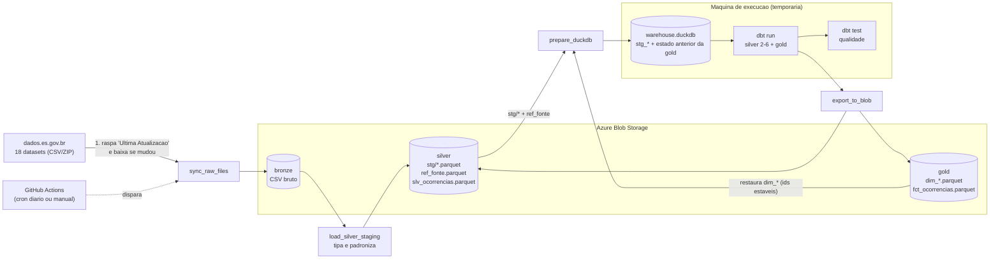

# Pipeline de Criminalidade -- Azure Blob Storage + DuckDB + dbt

[](https://github.com/Vinill2/pipeline-medalhao-crimes-es/actions/workflows/ci.yml) [](https://github.com/Vinill2/pipeline-medalhao-crimes-es/actions/workflows/pipeline.yml)

**Site publicado:** dashboard e dicionario de dados em https://vinill2.github.io/pipeline-medalhao-crimes-es/

Pipeline medalhao (bronze -> silver -> gold) com os dados abertos de criminalidade do
Espirito Santo (`dados.es.gov.br`). Armazenamento em Azure Blob Storage, transformacao
com dbt sobre DuckDB local, orquestracao via GitHub Actions.

## Diagrama



| Camada | Container Azure | Formato | Quem escreve |
|---|---|---|---|
| Bronze | `bronze` | CSV (bruto, como veio do site) | `src/sync_raw_files.py` |
| Silver (staging, etapa 1) | `silver` (`stg/*.parquet`, `ref_fonte.parquet`) | Parquet | `src/load_silver_staging.py` |
| Silver (final) | `silver` (`slv_ocorrencias.parquet`) | Parquet | dbt (DuckDB) |
| Gold | `gold` (`dim_*.parquet`, `fct_ocorrencias.parquet`) | Parquet | dbt (DuckDB) |

> Os nomes dos containers vem de `config/settings.json` (`azure.bronze_container`,
> `silver_container`, `gold_container`); ajuste la se os seus tiverem outro nome.

**Como funciona sem nenhum banco "ao vivo":** o DuckDB roda so localmente, dentro de
cada execucao (VSCode ou GitHub Actions). O estado que importa (os ids ja atribuidos
a cada dimensao) vive nos Parquet do container `gold`. A cada execucao:

1. Verifica no site se cada dataset foi atualizado e baixa so os que mudaram pro `bronze`.
2. Le, tipa e limpa os CSVs **que mudaram**, sobe como Parquet no `silver` (`stg/*`). Os demais `stg` sao reaproveitados.
3. Baixa os `stg/*.parquet` e os `dim_*`/`fct_ocorrencias` ja existentes no `gold`
   pra um arquivo DuckDB local temporario.
4. Roda o dbt em cima desse arquivo -- as dimensoes incrementais enxergam o que ja
   existia e so adicionam valor novo, sem reatribuir id antigo.
5. Exporta as tabelas finais de volta pro `silver` e `gold`, sobrescrevendo a versao
   anterior (sempre a ultima versao completa, sem acumular historico).

## Setup

```bash
python -m venv .venv
.venv\Scripts\activate          # Windows (Linux/Mac: source .venv/bin/activate)
pip install -r requirements.txt
```

Defina a connection string da Storage Account (copie `.env.example` para `.env` e
preencha, ou exporte direto no terminal):

```bash
set AZURE_STORAGE_CONNECTION_STRING=...   # Windows (cmd)
$env:AZURE_STORAGE_CONNECTION_STRING="..." # Windows (PowerShell)
export AZURE_STORAGE_CONNECTION_STRING=... # Linux/Mac
```

No GitHub Actions essa variavel vem de um **Secret** do repositorio chamado
`AZURE_STORAGE_CONNECTION_STRING` (Settings -> Secrets and variables -> Actions),
nunca de um `.env` commitado.

## Executar (na raiz do projeto)

Um comando roda tudo em sequencia (sync -> silver -> DuckDB -> `dbt run` -> `dbt test` -> export):

```bash
python -m src.pipeline              # uso normal (incremental)
python -m src.pipeline --force      # reprocessa tudo (use depois de mudar regras de limpeza)
python -m src.pipeline --skip-tests # nao roda o dbt test
```

No fim ele mostra o tempo de cada etapa. Cada etapa tambem roda isolada, se precisar depurar:

```bash
python -m src.sync_raw_files
python -m src.load_silver_staging [--force]
python -m src.prepare_duckdb
cd dbt_project && dbt run --profiles-dir . && dbt test --profiles-dir . && cd ..
python -m src.export_to_blob
```

### O que e pulado e quando (so reprocessa o necessario)

| Situacao | O que acontece |
|---|---|
| Nenhum CSV mudou **e** silver/gold ja estao em dia | Para logo depois do sync ("Nada a fazer") |
| So alguns CSVs mudaram | So esses viram `stg` de novo; `prepare_duckdb`, dbt e export rodam por completo (a gold depende de todos os datasets) |
| `--force` | Reprocessa os 18, sem checar nada |

A decisao e feita **comparando datas de modificacao dos blobs no Azure**, sem estado extra:
o `stg` de um dataset esta em dia se for mais novo que o CSV dele no bronze; a gold esta em dia
se o `fct_ocorrencias` e o `slv_ocorrencias` forem mais novos que o `stg` mais recente. Por isso,
se uma execucao cair no meio (bronze novo, gold velha), a proxima conserta sozinha.

**Importante:** o pipeline nao percebe mudancas no **codigo** (ex: nova regra de limpeza em
`src/reader.py`) nem em `titulo` no `sources.json`. Depois de mexer nisso, rode com `--force`.

Regras de seguranca do orquestrador:
- Se algum dataset falhar na carga do silver, para **antes** do dbt (nao gera gold com dado incompleto).
- Se o `dbt test` falhar, para **antes** do export (silver/gold no Azure continuam com a versao anterior).

## Criterio de atualizacao (quando um dataset e baixado de novo)

Cada entrada de `config/sources.json` tem o campo `pagina_dataset` (a pagina do
dataset em `dados.es.gov.br/dataset/<slug>`). A cada `sync_raw_files`, para cada dataset:

1. O pipeline le a **"Ultima Atualizacao" que esta no site agora** (raspagem da pagina).
2. Compara com `data_ultima_atualizacao_site`, que guarda a data do site da
   **ultima sincronizacao bem-sucedida** (ver "Onde fica o estado" abaixo).
3. Decide:

| Situacao | Acao |
|---|---|
| Arquivo nao existe no `bronze` | baixa |
| Data do site **diferente** da salva | baixa |
| Data do site igual a salva | pula |
| Nao foi possivel ler a data do site (pagina fora do ar, layout mudou) e o arquivo ja existe | pula e avisa no log |

O criterio e a data do **site**, nao o relogio da maquina que roda o pipeline (isso
evita erro de fuso entre o seu PC e o runner do GitHub, que roda em UTC).

A data so e gravada **depois** do upload ter dado certo, e e salva a cada dataset
concluido. Se um download falhar no meio (timeout, etc.), o que ja subiu nao e baixado de
novo na proxima execucao, e o que falhou e tentado novamente.

`data_atualizacao_sistema` continua sendo gravada (quando o pipeline sincronizou), mas e so
informativa, nao entra na decisao.

### Onde fica o estado (e por que nao e no Git)

- `config/sources.json` (no repositorio) e so **configuracao**: nome, titulo, link, pagina.
  O pipeline nunca o reescreve.
- O **estado** (`data_ultima_atualizacao_site`, `data_atualizacao_sistema`) fica no Azure, no
  blob `_state/manifest_state.json` do container bronze. Na primeira execucao, vale o valor
  inicial que estiver no `sources.json`.

Motivo: o `GITHUB_TOKEN` do Actions nao consegue driblar a protecao do ramo `main`. Se o
pipeline commitasse o manifesto, proteger o `main` o quebraria. Com o estado no Azure, o robo
nao commita nada, o PC e o GitHub compartilham o mesmo estado, e nao existe mais conflito de
`git pull` no `sources.json`.

Para adicionar um dataset: inclua a entrada no `sources.json` (sem datas) e abra um PR; ele e
baixado na proxima execucao.

## Logs

Formato (configuravel em `config/settings.json` -> `logging`):
`AAAA-MM-DD HH:MM:SS | NIVEL | mensagem`.

O `sync_raw_files` loga, por dataset, a decisao **e o motivo**, e um resumo no fim:

```
[2/18] roubo_celular: BAIXADO e enviado pro bronze -- site atualizado (2026-05-01T10:00:00 -> 2026-06-01T10:00:00) (42.1s)
[3/18] furto_celular: pulado -- site sem mudanca desde 2026-05-01T10:00:00 (0.9s)
[4/18] furto_pessoa: pulado -- data do site indisponivel, mantendo o bronze atual (0.4s)
sync concluido: 1 baixado(s), 17 pulado(s), 18 total
```

- `WARNING` = algo degradado mas que nao interrompeu (ex: nao conseguiu raspar a data de um dataset).
- `ERROR` no `load_silver_staging` = aquele dataset falhou e o script seguiu com os demais;
  **confira se ha linhas ERROR** mesmo quando o comando termina sem excecao.
- Os logs HTTP do SDK do Azure (cada requisicao, inclusive os `404` esperados na
  primeira execucao da gold) ficam silenciados (nivel `WARNING`, em `src/__init__.py`).

## Testes de qualidade (dbt)

Ficam em `dbt_project/models/silver/schema.yml` (usando os testes genericos de
`dbt_project/tests/generic/`) e rodam sobre a entrega final da Silver, `slv_ocorrencias`:

| Coluna | Teste | Regra |
|---|---|---|
| `no_ocorrencia` | `unique`, `not_null` | unico campo que precisa ser unico e preenchido |
| `data_do_fato`, `data_de_criacao` | `is_date_or_null` | NULL/vazio aceito; texto que nao seja data valida **falha** |
| `hora_do_fato`, `hora_de_criacao` | `is_time_or_null` | NULL/vazio aceito; texto que nao seja `HH:MM:SS` valido (00:00:00 a 23:59:59) **falha** |
| `idade` | `is_integer_or_null` | NULL/vazio aceito; se preenchida, somente digitos (texto como `S/I` ou `30 anos` **falha**) |

```bash
cd dbt_project
dbt test --profiles-dir .
dbt test --profiles-dir . --store-failures   # guarda as linhas que falharam em tabelas pra inspecionar
```

**Importante sobre o que esses testes enxergam:** a Silver ja converte lixo em `NULL`
(`indeterminado` na hora, `S/I` na idade, data fora do formato). Como NULL e aceito em
data, hora e idade, um valor invalido na origem **nao e detectado** aqui (ja virou NULL
antes do teste). Esses testes garantem o contrato da coluna final: nada alem de valor
valido ou vazio sai da Silver.

## Testes automatizados

```bash
pip install -r requirements-dev.txt
python -m pytest                       # tudo (~1 min)
python -m pytest -m "not integration"  # so os rapidos (~1 s), sem rodar o dbt
```

| Arquivo | O que garante |
|---|---|
| `test_columns.py`, `test_reader.py` | normalizacao de colunas (`Nº` vs `N°`), detecao de encoding/separador, limpeza de valores |
| `test_site_date_scraper.py` | leitura da data na pagina do site, com e sem o campo |
| `test_manifest.py` | decisao por data do site; estado no Azure nunca reescreve o `sources.json` |
| `test_sync.py` | baixa so o que mudou; progresso sobrevive a uma falha no meio |
| `test_freshness_and_load.py`, `test_pipeline_flow.py` | pula o que esta em dia, `--force`, para sem novidade, se recupera de execucao interrompida, falha bloqueia o export |
| `test_dbt_models.py` (integracao) | roda o **dbt de verdade** sobre dados ficticios: 26 modelos, testes de qualidade passam em dado limpo e **falham** em dado ruim, e **ids das dimensoes nao mudam** entre execucoes |
| `test_dashboard.py`, `test_build_site.py` | agregados do dashboard fecham com o total, o HTML nao vaza dado individual nem aceita injecao, o dbt docs e gerado |

Os testes nao usam Azure nem segredos. Para nao tocar no seu warehouse real, o dbt le o
caminho do banco da variavel `DUCKDB_PATH` (padrao: `data/work/warehouse.duckdb`).

## CI/CD

| Workflow | Quando roda | O que faz |
|---|---|---|
| `ci.yml` | a cada Pull Request e push no `main` | instala as dependencias fixadas e roda o `pytest` completo |
| `pipeline.yml` | todo dia 06:00 UTC ou manual (com opcao `force`) | roda `python -m src.pipeline` no Azure; avisa no Discord se falhar |
| `pages.yml` | apos o pipeline dar certo, ao mudar dbt/dashboard, ou manual | gera o site (dashboard + dbt docs) e publica no GitHub Pages |
| `dependabot.yml` | semanal | abre PR quando sai versao nova de uma dependencia ou action; o CI valida |

- **Versoes fixadas** em `requirements.txt` (reprodutivel); `requirements-dev.txt` acrescenta o pytest.
- **Protecao do `main`** (configurada no GitHub, nao no codigo): so entra codigo via Pull Request
  com o check `tests` do CI aprovado.
- O pipeline de producao tem so permissao de leitura no repositorio e nao faz commit.

## Site publicado

- **Dashboard** (`src/dashboard.py`): le so **agregados** da gold (por mes, municipio, tipo de crime,
  hora, dia da semana, faixa etaria, sexo). Nenhum numero de ocorrencia, logradouro ou bairro e publicado.
  HTML unico, sem bibliotecas externas.
- **Dicionario de dados e linhagem** (`dbt docs`): gerado a partir das descricoes dos
  `schema.yml`, sobre um warehouse ficticio (so a estrutura importa).
- Para ver localmente: `python -m src.build_site --skip-dashboard` (so o dbt docs, sem Azure) ou
  `python -m src.dashboard --output site/index.html --gold-dir PASTA_COM_PARQUETS`.

## Pendencias

- Atualizar o dbt: a linha 1.7 (`dbt-core`/`dbt-duckdb`) nao recebe mais patches regulares; o Dependabot
  vai propor a subida e o CI mostra se algo quebra.
- Nota: das 22 `dim_*`, 21 sao incrementais; `dim_incidente` e reconstruida a cada execucao
  (os codigos vem da origem, entao nao ha id proprio para proteger).

## Removido na migracao

- SQLite e `dbt-sqlite` (trocados por DuckDB local + dbt-duckdb).
- `src/storage.py` e qualquer tabela em banco: agora tudo e Parquet no Blob.
- `data/dados_crimes.db`: nao existe mais; `data/work/` e so uma pasta de trabalho
  temporaria (no `.gitignore`), recriada do zero a cada execucao.
